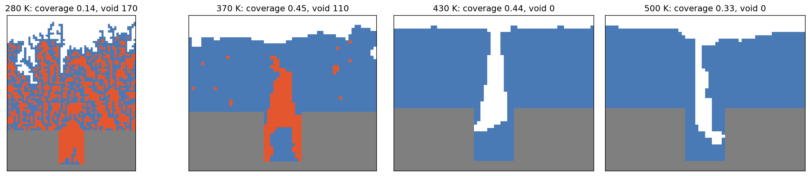

# Thin Film Growth: Monte Carlo Simulation

> **New to Python, or just want to try it?** See [START_HERE.md](START_HERE.md): download the ZIP,
> double-click `start_windows.bat` (Windows) or `start_mac.command` (macOS), and it sets everything up.

Monte Carlo models of atoms depositing onto a surface. The project asks two
questions that matter in thin-film deposition in semiconductor fabs:

1. How do substrate temperature and deposition rate control film roughness?
2. When does filling a trench seal off a void?

The models build up in four steps. Each new physical ingredient is validated
against known theory before the next one is added. A Streamlit app lets you
watch any model grow live.

## Results at a glance

| Phase | Model | Key result | Check |
|---|---|---|---|
| 1 | Random deposition | W ~ t^beta, **beta = 0.503** | theory 1/2, and matches the exact W(t) within 5% |
| 2 | Surface relaxation | **beta = 0.248**, W saturates, **W_sat ~ L^0.53** | Edwards-Wilkinson: 1/4 and 1/2; data collapse with z = 2 |
| 2 | Numba | **~130x** faster than plain Python (3.7e8 vs 2.9e6 atoms/s) | identical films from both versions |
| 3 | Thermal hopping | roughness falls **5x** from 250 K to 450 K and rises **5x** from 0.01 to 1000 ML/s | the hops = 0 limit reproduces random deposition |
| 4 | Trench filling | voids vanish above ~430 K for trenches with width >= depth; narrow trenches void at every temperature tested | flood-fill tests on hand-built grids |



## Reports

* [Project report](https://nhamhung.github.io/thin-film-growth/) (*How Thin Films Grow*): methods, key results,
  findings and limitations.
* [Beginner's guide](https://nhamhung.github.io/thin-film-growth/beginners-guide.html): a plain-language introduction
  to the science, simulations and main results.
* [Simulator user guide](https://nhamhung.github.io/thin-film-growth/user-guide.html): a guided tour of the app with
  screenshots, three hands-on experiments, troubleshooting and a glossary.

Render with `cd report && QUARTO_PYTHON=../.venv/bin/python quarto render report.qmd && quarto render user_guide.qmd`.

## The physics in one paragraph per phase

**1. Random deposition.** Each atom lands in a random column and stays there.
Columns never interact, so each column's height is Binomial(t, 1/N). This gives
the exact result W = sqrt(t (1 - 1/N)). W grows as t^1/2 without limit.

**2. Surface relaxation.** A landed atom rolls into a lower neighbouring column
(chosen at random if both are lower). Boundaries are periodic. This one local
rule makes the surface smooth itself: W grows as t^1/4 and then saturates at
W_sat ~ L^1/2 after a time ~ L^2.

**3. Temperature.** Between landings, surface atoms hop sideways with probability
exp(-n E_bond / kT), where n is the number of side neighbours. The hop rate
follows the Arrhenius law, nu0 exp(-E_diff / kT), so the number of hops per
landed atom is hops = nu0 exp(-E_diff / kT) / F, where F is the flux. Hot
substrates and slow deposition give atoms time to find well-bonded sites, which
makes films smooth. Cold substrates and fast deposition make them rough.
Defaults: E_bond = 0.2 eV, E_diff = 0.8 eV, nu0 = 1e13 /s.

**4. Trench filling.** This is a 2D side view with three cell types: empty,
substrate and film. Atoms fall straight down and stick on first contact, below
or beside. That makes overhangs grow from the trench corners. The newly landed
atom then hops (same Arrhenius law) toward empty sites with more bonds. Voids
are the empty cells that a breadth-first flood fill from the open space above
cannot reach. **Step coverage** = film mass per column on the trench bottom /
film mass per column on top. The trench model uses a weaker bond,
E_bond = 0.1 eV. At 0.2 eV, bonded atoms in 2D hardly move at any temperature,
so every trench voids.

## The app

`streamlit run app/streamlit_app.py` (from the project root, so the dark theme in `.streamlit/` applies).

* **Sidebar recipe:** process module (PM1–PM4), temperature, deposition rate and
  trench geometry, with both units shown (K / °C, ML/s / nm/min). **⭐ Load POR**
  loads the process of record, the recommended recipe below. Frames and seed are
  under *Advanced*.
* **▶ Run wafer** simulates the run, then replays it in the browser with
  play/pause/scrub. You get:
  * a process stepper (load → pump down → heat chuck → deposit → cool → inspect);
    only *deposit* is simulated, and *skip intro* jumps straight to it;
  * a chamber schematic: plasma and atom flux follow the deposition rate, and the
    chuck glows with temperature;
  * tool readouts with every wafer's metrics side by side, and the key metric over
    time against its spec;
  * an **in-situ** cross-section coloured by growth time, with trench voids in red;
  * a **simulated SEM** rendering with a scale bar, shown automatically at *inspect*;
  * an AFM strip for the 1D modules.
* **⇄ Compare with POR** runs your recipe and the POR with the same seed, side by side.
* **Lot history:** each wafer gets an ID (`TF-0001-W03`), a PASS/FAIL against spec and a trend chart.
* **Export:** standalone HTML replay, recipe/settings JSON, lot CSV.

Specs (`src/thin_film/fab.py`) are single-wafer limits:

* PM3: Rq ≤ 2.0 atoms at 100 ML. The POR passed all 30 seeds tested; 375 K at 1 ML/s fails almost every wafer.
* PM4: trench void = 0 and step coverage ≥ 0.50. The POR passes about 80% of wafers (24 of 30 seeds), which
  is the run-to-run variation of the model, not a bug.

The SEM view is a rendering of the simulation, not microscope data. Lengths
assume 1 ML ≈ 0.3 nm. 1D cross-sections print how much they are stretched.

### Ideal configurations (POR)

The values live in `src/thin_film/ideal.py`, each with its reasoning. The
thermal and trench values come from grid searches saved as
`results/phase3_process_window` and `results/phase4_process_window`.

| Model | Ideal config | Why |
|---|---|---|
| Random deposition | 200 columns, 1000 ML | Nothing to tune; gives a clean t^1/2 curve |
| Surface relaxation | 100 columns, 3000 ML | Nothing to tune; shows both the rise and the plateau |
| Thermal hopping | 375 K, 0.01 ML/s | Smoothest film in the grid (W = 0.91 vs 2.5 at 1 ML/s) |
| Trench filling | 16 × 16 trench, 420 K, 1 ML/s | Void-free, coverage 0.59; trenches 2× deeper than wide void at every setting tested |

## Model limitations (read before quoting numbers)

* All units are lattice cells. Temperatures are meaningful only relative to the
  chosen barriers (E_bond, E_diff), which are illustrative, not fitted to a
  real material.
* Hop counts are capped for run time: 1e4 per landing in 1D, 3000 per atom in
  2D. In the trench model, the slight rise in void area above ~460 K is caused
  by this cap. Hops stop increasing while bonds keep weakening.
* In 2D only the newest atom hops. Buried atoms are frozen.
* An open seam reaching the surface is not counted as a void, by definition
  (only sealed space counts). It is visible in the 430–500 K cross-sections.
* Cold sticky films are porous (density ~0.5). `total_void_area` counts those
  pores; `trench_void_area` counts only sealed space inside the trench.

## Layout

```
src/thin_film/
  roughness.py           # W, power-law fit (SciPy curve_fit), log-spaced times, ensemble averaging
  units.py               # real units (K, eV, ML/s) -> (epsilon, hops)
  random_deposition.py   # Phase 1
  surface_relaxation.py  # Phase 2 (Python + Numba kernels)
  thermal.py             # Phase 3 (Numba)
  trench.py              # Phase 4 (Numba deposition + BFS void detection)
  plotting.py            # shared plots and matplotlib animations
  results.py             # save_result: settings.json (+ versions) next to data.csv / figure.png
  ideal.py               # POR recipes and the evidence for each
  fab.py                 # fab vocabulary: unit conversions, recipe names, wafer IDs, specs
  recording.py           # record a run as compact frames for replay (exactly reproducible)
scripts/run_phase{1..4}.py   # regenerate everything in results/
scripts/run_por_yield.py      # single-wafer pass rates behind the specs
report/                       # report.qmd (findings) + user_guide.qmd (app guide), rendered to HTML
notebooks/0{1..5}_*.ipynb     # step-by-step guides for beginners (local or Google Colab), see below
app/streamlit_app.py          # app: recipe sidebar, run/compare, lot history
app/fab_player.html           # in-browser replay: stepper, chamber, readouts, in-situ / SEM / AFM views
app/player.py                 # packs recordings into the player page
.streamlit/config.toml        # dark theme
tests/                        # validation checks for every phase + app smoke tests
results/<experiment>/         # each result saved with the exact settings and seed
```

## Run

```bash
python3.12 -m venv .venv && source .venv/bin/activate
pip install -r requirements.txt

pytest                                    # 47 validation, player and app tests, ~10 s
for p in 1 2 3 4; do PYTHONPATH=src python scripts/run_phase$p.py; done   # ~1 min total
PYTHONPATH=src python scripts/run_por_yield.py                          # POR pass rates, ~2 min
streamlit run app/streamlit_app.py        # the app (run from the project root for the theme)
```

Every random draw comes from a fixed seed (`seed` in each settings
dataclass), so reruns reproduce `results/` exactly, given the same library
versions, which are recorded in each `settings.json`.

## Notebooks

Five step-by-step guides for readers with basic Python and no physics background. Run them in order, top to
bottom, with the *Thin Film Growth* kernel (`thin-film-growth`, this `.venv`). Each one runs a tiny simulation by hand
next to the project's function, scales up, reproduces the saved `results/`, and ends with a step → module → script
map and exercises. They only read `results/` and never write project files.

| Notebook | Covers | Runtime |
|---|---|---|
| `01_random_deposition` | seeds and Monte Carlo, the deposition rule by hand, roughness W, log-log fits and beta, exact binomial theory | ~5 s |
| `02_surface_relaxation` | the relaxation rule by hand, beta, saturation, alpha, data collapse, Numba JIT and timing, identical-output check | ~5 s |
| `03_temperature_model` | kT, Arrhenius and flux to (epsilon, hops), the hop rule by hand vs the Numba kernel, sweeps, noise, process window, thermal POR | ~40 s |
| `04_trench_filling` | the trench grid, falling/sticking/hopping by hand vs Numba, flood-fill void detection, `measure` by hand, sweeps, hop cap, process window, trench POR | ~35 s |
| `05_por_yield_and_app` | POR recipes, fab units and specs, recording and replay, single-wafer yield, how the Streamlit app and player fit together | ~25 s |

**Google Colab:** the first cell of each notebook gets the project code. It
clones `github.com/nhamhung/thin-film-growth` if that repository exists.
Otherwise it mounts Google Drive and uses `MyDrive/thin_film_growth`, so copy
the project folder there. It then installs Numba.
