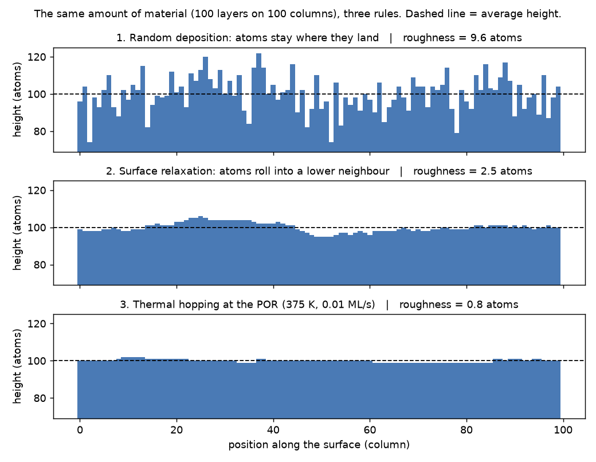

::: {.callout-tip appearance="simple"}
## Who this is for

No background in chips, physics, statistics or programming is needed. Technical words are explained on first use
and in the [Glossary](#glossary). The technical write-up is *How Thin Films Grow* (`report/report.html`); the app
tour is *Using the Thin Film Growth Simulator* (`report/user_guide.html`).
:::

# The question in one paragraph

Computer chips are built by laying down extremely thin coatings, called **thin films**, one on top of another.
A thin film is a layer of material only a few to a few hundred atoms thick. It is made by **deposition**: atoms
are sent toward a silicon disc (a **wafer**) and allowed to settle on it, a bit like snow falling on a table. This
project asks two questions about that process. First: *how do the wafer's temperature and the speed at which atoms
arrive decide whether the finished film is smooth or rough?* Second: *when we try to fill a narrow trench etched
into the wafer, when does the coating close over the top and trap an empty pocket (a **void**) inside?* The project
answers both with a **simulation**: a computer program that plays out the falling and settling of atoms one by
one, using simple rules, so we can watch what happens and measure it.

# Why it matters

* **Chips.** A chip is a stack of dozens of films, and its metal wires are made by etching tiny trenches and filling
  them with metal. A **rough** (bumpy) film makes the next layer uneven. A void in a trench is a hole in a wire:
  higher resistance and a weak spot that can fail later.
* **Coatings in general.** The same physics applies to lens, mirror and tool coatings and to solar cells.
* **The trade-off.** Chip factories (**fabs**) face a tug of war. Heat helps atoms settle into good spots but costs
  energy and can damage what is already built. Slow deposition gives atoms time to settle but means fewer wafers
  per hour. This project puts numbers on that trade-off.

# The "data", explained

## There is no downloaded dataset

All the data is **generated** by the simulation. The method is called **Monte Carlo** (after the casino): lots of
random dice rolls. Each atom lands at a random spot, and whether it then moves is decided by a dice roll with
carefully chosen odds. Two ideas make this trustworthy:

* **Seeds make it repeatable.** A computer's "random" numbers come from a starting number, the **seed**. The same
  seed always gives the same dice rolls, so the same film, and every result records its seed.
* **Averaging.** One film is noisy, like one coin toss, so most results average 4 to 30 independent films.

## The world inside the simulation

The simulated world is a grid of cells, each the size of one atom.

* In the **1D models**, the surface is one row of side-by-side columns (usually 200), like a row of stacks of coins
  seen from the side. A film is just a list of stack heights.
* In the **2D trench model**, we see a side view of a wafer with a rectangular trench cut into it. Each cell is
  empty, original wafer material (the **substrate**), or new film.

Time is counted in **monolayers (ML)**: enough atoms to cover the surface one atom thick. The app assumes
1 ML is about 0.3 nm, an illustrative choice.

The two knobs a process engineer would turn are:

* **Temperature**, in **kelvin (K)**, a scale starting at absolute zero (room temperature is about 295 K; 375 K is
  about 102 °C). Heat lets atoms jiggle loose and move.
* **Deposition rate**, or **flux**: monolayers arriving per second (ML/s), tested from 0.01 (very slow) to 1000
  (very fast).

From these the model computes the key quantity, **hops per atom**: how many chances an atom gets to move sideways
before newer atoms bury it. Heat raises it; speed lowers it.

## What one run records: a real sample

Every experiment is saved in its own folder under `results/`, with a `settings.json` file (what was run) and a
`data.csv` table (what came out). Here is one experiment, `results/phase3_flux_sweep`, which asks: at a fixed
temperature, what does the arrival speed do to roughness?

**The settings** (from `settings.json`, the main entries):

| Setting | Value | Plain meaning |
|---|---|---|
| model | thermal hopping | the temperature-aware 1D model (Phase 3 below) |
| n_columns | 200 | the surface is 200 columns wide |
| n_monolayers | 50 | each film is grown 50 layers thick |
| n_runs | 8 | each setting is repeated with 8 different random films, then averaged |
| temperature | 375 K | wafer temperature, held fixed here |
| e_bond | 0.2 eV | how strongly an atom holds each side neighbour (eV, electronvolt, is a tiny unit of energy) |
| e_diff | 0.8 eV | how hard it is for a lone atom to hop (an energy barrier) |
| max_hops | 10,000 | a speed limit on the number of hops, to keep runs fast |
| seed | 42 | the starting number for the dice rolls |
| fluxes | 0.01, 0.1, 1, 10, 100, 1000 | the six deposition rates tested |

**The results** (all six rows of `data.csv`, rounded):

| flux (ML/s) | hops per landing | roughness (atoms) | roughness_sem |
|---|---|---|---|
| 0.01 | 10,000 (capped) | 1.12 | 0.07 |
| 0.1 | 1,772 | 1.57 | 0.13 |
| 1 | 177 | 1.85 | 0.13 |
| 10 | 17.7 | 2.73 | 0.10 |
| 100 | 1.8 | 4.32 | 0.11 |
| 1000 | 0.18 | 5.53 | 0.10 |

* **flux**: the arrival speed tested. **hops per landing**: sideways move attempts per new atom (at 0.01 ML/s it
  would exceed 10,000, so it is held at the cap).
* **roughness**: how bumpy the finished film is, in atoms (see below); lower is smoother.
* **roughness_sem**: the "give or take" on that average (its standard error): rerun with new seeds and the average
  would usually land within about this much.

Reading it: atoms arriving 100,000 times faster make the film about 5 times rougher.

A second kind of record is one simulated **wafer**, judged pass/fail (`results/por_yield/data.csv`):

| module | recipe | temperature (K) | flux (ML/s) | seed | roughness | step coverage | void (cells) | result |
|---|---|---|---|---|---|---|---|---|
| thermal | POR | 375 | 0.01 | 0 | 1.24 | | | PASS |
| thermal | 375 K, 1 ML/s | 375 | 1 | 0 | 2.18 | | | FAIL |
| trench | POR | 420 | 1 | 1 | | 0.67 | 0 | PASS |
| trench | 370 K, 1 ML/s | 370 | 1 | 1 | | 0.52 | 144 | FAIL |

Words like POR, step coverage and void are explained in the walkthrough below. Blank cells mean the measurement
does not apply to that kind of wafer.

## What the films look like

{width=85%}

Each bar is one column of stacked atoms. The dashed line is the average height. **Roughness** is the typical
distance of a column from that line. The top film, where atoms never move, is jagged (roughness about 9.6 atoms).
The middle one, where atoms roll into a lower neighbour, is gently wavy (about 2.5). The bottom one, grown with the
project's recommended temperature and rate, is nearly flat (about 0.8). Chip engineers call this measure **Rq**;
physicists call it **W**. They are the same number.

# The journey, step by step

The project was built in four phases, each adding one physical ingredient and each checked against known theory
(or hand-made test cases) before the next, like checking your scales with a known weight first.

## Phase 1: random deposition, the simplest possible film

**The rule.** Each atom picks a random column and sticks on top, never moving: snow on a table where every flake
freezes the instant it lands.

**Why bother?** This model has an exact pen-and-paper answer, so it tests the code. The answer: roughness grows
forever, with the square root of time (grow four times as long and the film is twice as rough).

**The growth exponent.** "How fast roughness grows" is summarised by one number, the **growth exponent**, **beta
(β)**. Smaller β means slower roughening. Theory says β = 1/2 here; the simulation (200 columns, 1000 layers, 30
films averaged) found **β = 0.503** and matched the exact curve within 5% at every time.

## Phase 2: surface relaxation, and a big speed-up

**The rule.** An atom lands in a random column, glances at its two neighbours, and if one is lower it rolls down into
it (if both are lower, it picks one at random). Think of sand: a grain on a peak slides into the nearest dip. The row
wraps around, so the last column's neighbour is the first, which avoids artificial walls at the edges.

**What changed.** This one tiny rule changes everything:

* Roughness grows much more slowly: β = **0.248**, against a theoretical 1/4.
* Roughness eventually **stops growing**, levelling off at a plateau (**saturation**) once the smoothing has spread
  across the whole surface.
* Wider surfaces level off higher and later: about 1.1, 1.6, 2.3 and 3.2 atoms for widths of 25, 50, 100 and 200
  columns. A second exponent, **alpha (α)**, measures this. Theory says 1/2 (four times wider gives a plateau twice
  as high); the simulation found **α = 0.53**.
* Rescaled by theory's rules, the four curves fall on top of each other (a "data collapse"), confirming the model
  belongs to a well-known family of surfaces (the Edwards-Wilkinson class).

**The speed-up.** Here each atom's fate depends on earlier atoms, so they must be handled one at a time, which is
slow in plain Python (the programming language used). A tool called **Numba** turns that loop into fast machine
code: about **2.9 million atoms per second** before, **370 million** after, roughly **130 times faster**. A test
confirms both versions build exactly the same film. This speed is what makes the interactive app possible.

## Phase 3: temperature and deposition rate

**The rule.** Atoms still land randomly. Between landings, surface atoms try to hop one column left or right. The
dice decide whether a hop succeeds, and the odds depend on how many side neighbours the atom has. A lone atom on a
flat stretch hops freely. One tucked against a step, or sitting in a groove between two neighbours, is held much
more firmly. Heat makes all hops more likely.

Temperature and rate are converted into hops per atom with the standard textbook rule for heat-driven hopping (the
**Arrhenius law**: hopping speeds up sharply as temperature rises). At 1 ML/s, the surface gets far less than one
hop per new atom at 250 K, about 177 at 375 K, and reaches the 10,000 cap by 450 K. As a check, with zero hops the
model reproduces Phase 1 exactly.

**What it showed:**

* **Heat smooths.** At 1 ML/s, warming from 250 K to 450 K cut roughness from about 6.9 to 1.3 atoms, about
  5 times smoother (`results/phase3_temperature_sweep`).
* **Speed roughens.** At 375 K, going from 0.01 to 1000 ML/s raised roughness from 1.1 to 5.5 atoms, about 5 times
  rougher (the sample table above).
* **Heat and slowness are interchangeable**, because both act only through hops per atom. The report estimates
  every extra 40 K allows about 10 times faster deposition at the same roughness.
* **Atoms must move *and* stick.** With bonding switched off, atoms wandered uphill as easily as downhill and the
  film became very rough (about 36 atoms). Even weak bonding brought it to about 4, moderate bonding to about 2
  (`results/phase3_epsilon_sweep`).

**Finding the best recipe.** A **recipe** is the set of machine settings for a run. The project tried all 66
combinations of 11 temperatures (300 to 550 K) and 6 rates (0.01 to 1000 ML/s). Such a map is called a **process
window**. The smoothest film came from **375 K at 0.01 ML/s** (roughness 0.91 after 50 layers, versus 2.47 at
1 ML/s): the coolest temperature at which slow deposition still maxes out the hops while bonds stay strong.

## Phase 4: filling a trench, and catching voids

**The picture.** A side view of a wafer with a rectangular trench, typically 12 cells wide and 16 deep, in a strip
128 cells wide. Atoms fall straight down.

**The rule.** An atom stops the moment it touches anything, below *or beside* it. Atoms brushing the trench's top
corners stick there, so ledges (**overhangs**) grow inward from both corners. If they meet before the bottom has
filled, they seal off an empty pocket: a **void**. Spray-painting the inside of a narrow trench has the same
problem: the rim gets coated first and blocks paint from reaching the bottom.

Heat helps as before: each new atom gets hop attempts and moves toward the empty spot with the most neighbours, so
warm atoms drift into corners and along the floor, filling the trench from the bottom up. (Only the newest atom
moves; buried atoms stay frozen. The bond here is weaker, 0.1 instead of 0.2, because at 0.2 atoms in 2D barely
moved and every trench voided.)

**How a void is found.** The program "pours water" in from the open space above. Any empty cell the water cannot
reach is sealed off: a void. This **flood fill** was tested on hand-drawn grids with known answers.

**What is measured:** **void area** (sealed empty cells inside the trench; zero is the goal), **step coverage** (film
thickness at the trench bottom divided by thickness on the flat top; 1 is even, near 0 means the bottom gets almost
nothing) and **film density** (fraction of the film that is solid).

**What it showed:**

* **Cold films are spongy and seal at once.** At 280 K the film was only about half solid, coverage about 0.17, and
  the average trench void about 160 cells (`results/phase4_temperature_sweep`).
* **Warmer films are dense but can still trap a void.** At 370 K the film was about 96% solid, but the overhangs
  still met in every run (average void 118 cells).
* **Hot enough, the trench fills.** At 430 K the average void shrank to about 9 cells (1 of 6 runs had one). A thin
  seam may stay open to the surface; it is not sealed, so it is not a void.
* **Above about 460 K voids creep back**, but this comes from the model's cap of 3000 hops per atom (extra heat
  stops adding hops but keeps weakening bonds), not from real physics.
* **Shape beats temperature.** At 450 K, trenches 4, 6 and 8 cells wide (depth 16) voided in every run, while widths
  16, 20 and 32 never did (one run in six at width 24 had a small void) (`results/phase4_width_sweep`). Depth
  divided by width is the **aspect ratio**: in deep, narrow trenches the corners are so close that the ledges meet
  after only a few layers.

**Finding the best recipe.** A second process window tried 3 widths (8, 12, 16) × 8 temperatures (380 to 520 K) × 4
rates (0.1 to 100 ML/s), 96 combinations, 8 runs each. The choice: a **16 × 16 trench at 420 K and 1 ML/s**,
void-free on average with step coverage about 0.59, near the best void-free coverage (0.60 at 520 K) but 100 K
cooler. At width 8, *no* combination avoided a void (smallest average about 53 cells).

## The process of record and the yield check

In a fab, the approved recipe that everyone runs by default is called the **process of record**, or **POR**. The
project names one POR per model (stored in `src/thin_film/ideal.py`, each with its reasoning):

| Model | POR | Why |
|---|---|---|
| Random deposition | 200 columns, 1000 layers | nothing to tune; shows the clean square-root growth |
| Surface relaxation | 100 columns, 3000 layers | nothing to tune; shows both the rise and the plateau |
| Thermal hopping | 375 K, 0.01 ML/s (100-layer film) | smoothest film in the process window |
| Trench filling | 16 × 16 trench, 420 K, 1 ML/s (24 layers) | void-free with good step coverage |

Averages can hide bad individual wafers, and a real fab judges each wafer on its own against a pass/fail rule
called a **spec**. The project's specs (in `src/thin_film/fab.py`) are:

* Thermal film: roughness at most 2.0 atoms after 100 layers.
* Trench: no void and step coverage at least 0.50.

Each recipe was then run on 30 separate simulated wafers with different seeds (`results/por_yield`). The share that
pass is the **yield**.

| Model | Recipe | Wafers passing (of 30) |
|---|---|---|
| Thermal | POR: 375 K, 0.01 ML/s | 30 |
| Thermal | 450 K, 1 ML/s (100× faster) | 24 |
| Thermal | 375 K, 1 ML/s | 2 |
| Trench | POR: 420 K, 1 ML/s | 24 |
| Trench | 460 K, 10 ML/s (10× faster) | 16 |
| Trench | 370 K, 1 ML/s | 9 |

The trench POR passes about 80% of wafers. The six failures were near misses: coverage just under 0.50, or a tiny
void of 1 to 6 cells. This spread between wafers made with the same recipe is a genuine feature of random growth,
not a bug, and it is exactly why a recipe that looks fine "on average" can still disappoint on the factory floor.

## The app: a virtual deposition tool

Finally, everything was wrapped in an interactive app (built with Streamlit, a tool for making web apps in Python)
styled like the control screen of a real deposition machine. It is described in [Try it yourself](#try-it-yourself).

# What we found

1. **The simulation passes its exams:** β = 0.503 for random deposition (theory 0.5); β = 0.248 and α = 0.53 with
   relaxation (theory 0.25 and 0.5).
2. **Rolling downhill tames roughness:** it levels off, higher on wider surfaces (about 1.1 to 3.2 atoms for widths
   25 to 200).
3. **Numba makes it about 130× faster** (2.9 million vs 370 million atoms per second).
4. **Heat smooths and speed roughens, about 5× each** (250 to 450 K; 0.01 to 1000 ML/s), both through hops per atom.
5. **Atoms must be able to stick:** no bonding gives roughness about 36; weak bonding about 4.
6. **Smoothest 1D recipe:** 375 K at 0.01 ML/s, roughness 0.91 after 50 layers; 30 of 30 test wafers pass.
7. **Trench shape first, temperature second:** trenches twice as deep as wide (or narrower) voided at every setting
   tried; trenches as wide as deep fill once hot enough.
8. **Cold films are spongy:** about half solid at 280 K, nearly solid from about 370 K.
9. **Trench POR** (16 × 16, 420 K, 1 ML/s): void-free on average, coverage about 0.59, 24 of 30 wafers pass;
   faster or cooler alternatives pass 16 and 9 of 30.

# How to read the main charts

## Log-log roughness chart

{width=60%}

* Time (layers) runs along the bottom, roughness up the side. Both axes are **logarithmic**: each major gridline is
  ten times the last. On such axes a steady growth rule becomes a straight line whose steepness *is* β.
* Dots are the simulation, the red line exact theory, the dashed line a slope-1/2 reference. They overlap, which is
  the point.
* In the Phase 2 chart (`results/phase2_surface_relaxation/figure.png`) the lines rise then go flat: saturation.

## Process-window heat map

{width=70%}

* Each square is one recipe: temperature up the side, rate along the bottom (each step ten times faster). The
  number is roughness after 50 layers; yellow is smooth, dark purple rough.
* Smooth is top-left (hot, slow), rough is bottom-right (cold, fast). The diagonal bands are the trade-off: going
  hotter lets you go faster at the same roughness.
* The trench version (`results/phase4_process_window/figure.png`) has one such map of void area and one of step
  coverage for each trench width.

## Trench cross-sections

{width=85%}

* Grey is the original wafer, blue is new film, red is a sealed void, white is open space.
* On the left you can see the overhangs from both corners meeting above a red pocket. On the right the bottom has
  filled; the white slot still opens to the top, so it is not a void.

# Try it yourself

## The app in plain words

The app is a small virtual deposition machine. From the project folder you start it with one command
(`streamlit run app/streamlit_app.py`) and it opens in your web browser. *Using the Thin Film Growth Simulator*
(`report/user_guide.html`) walks through every button with screenshots. In short:

* **Pick a process module:** PM1 (random deposition), PM2 (surface relaxation), PM3 (thermal hopping) or PM4
  (trench fill).
* **Set a recipe** with sliders: temperature (250 to 550 K), rate (0.01 to 1000 ML/s), and trench width and depth
  for PM4. **Load POR** fills in the recommended recipe.
* **Run wafer** simulates the run in a second or a few, then replays it like a video you can pause and scrub.
* **The process stepper** shows a real tool's sequence: load, pump down, heat chuck, deposit, cool, inspect. Only
  "deposit" is simulated; the rest are short animations (skippable).
* **The chamber drawing** shows a sputtering tool whose plasma and falling atoms get busier at higher rates, and a
  wafer holder (chuck) that glows warmer at higher temperatures.
* **Readouts and trace** show each wafer's key number (roughness, or void and coverage) over time against the spec.
* **Three views of the film:** *in-situ* (a cross-section coloured by when each part grew, voids in red), *simulated
  SEM* at the end (styled like an electron-microscope image; a drawing, not a real one), and for 1D modules an *AFM
  strip* (a top-down colour bar of high and low spots).
* **Compare with POR** grows your recipe and the POR side by side with the same seed, so differences come from the
  recipe, not luck.
* **Lot history** logs every wafer with an ID like TF-0001-W03, PASS/FAIL (or MONITOR for PM1/PM2, which have no
  spec), the yield and a trend chart. **Export** saves a replay page, the recipe and seed, and the log.

A good first experiment: choose PM4, press Load POR, lower the temperature to about 360 K, and press Compare with
POR. Watch the left trench seal over a red void while the right one fills. Then set the trench width to 8 and try
again: no temperature saves it.

## Where everything else lives

* `report/report.html` (technical report) and `report/user_guide.html` (app tour, guided experiments).
* `notebooks/01_random_deposition.ipynb` to `05_por_yield_and_app.ipynb`: step-by-step guides for developers,
  one per phase plus one on the recipes, wafer pass rates and the app. Each runs a tiny simulation you can
  follow atom by atom, then the real one. Runnable locally or in Google Colab.
* `results/`: every experiment's settings, data and chart; `scripts/` regenerates them.
* `tests/`: automated checks (the README counts 47), e.g. that random deposition matches theory, that the fast and
  slow Phase 2 code agree exactly, that no atoms are created or lost, and that the flood fill finds only sealed
  pockets.

# What this project can't tell you

* **It is a cartoon of real atoms:** one atom per square cell, one kind of atom, and atoms falling straight down.
  Real atoms arrive at angles, which matters a lot for overhangs.
* **Temperatures are relative.** The bond and hop energies illustrate the physics; they are not measured for any
  real metal. "420 K" means "warm enough *in this model*". The nanometre values (1 layer ≈ 0.3 nm) are illustrative
  too.
* **Speed limits.** Hops are capped (10,000 per atom in 1D, 3000 in the trench) to keep runs fast; the slight rise
  in trench voids above about 460 K comes from this cap.
* **Simplified trench motion:** only the newest atom moves; buried atoms are frozen. Open seams are not counted as
  voids, by definition.
* **Small and noisy:** surfaces a few hundred cells wide, averages of 4 to 30 runs.
* **No real measurements:** nothing was compared with real fab or microscope data, and the app's SEM and AFM views
  are drawings of the simulation.
* **Real fabs use other tricks** for deep, narrow trenches (reflowing the metal, atomic layer deposition,
  electroplating), none of which are modelled.

# Glossary {#glossary}

| Term | Meaning |
|---|---|
| **Alpha (α)** | Saturation exponent: how much the roughness plateau rises as the surface gets wider. Theory 1/2; measured 0.53. |
| **AFM** | Atomic force microscope: a tool that maps surface heights from above. In the app, a colour strip of high and low spots. |
| **Arrhenius law** | The standard rule that heat-driven events (like an atom hopping) speed up sharply as temperature rises. |
| **Aspect ratio** | Trench depth divided by width. High aspect ratio = deep and narrow = hard to fill. |
| **Beta (β), growth exponent** | How fast roughness grows with time. 1/2 for random deposition, 1/4 with relaxation; smaller = slower roughening. |
| **Deposition** | Laying down a film by sending atoms at a surface and letting them settle. |
| **Deposition rate / flux** | How fast atoms arrive, in monolayers per second (ML/s). |
| **Fab** | A chip factory. |
| **Film density** | Fraction of the film that is solid rather than pores. |
| **Flood fill** | A way to find voids: "pour" from the open space above and see which empty cells are never reached. |
| **Hops per atom** | How many chances a landed atom gets to move before new atoms bury it. Heat raises it; speed lowers it. |
| **Kelvin (K)** | Temperature scale starting at absolute zero; °C = K − 273.15. |
| **Monolayer (ML)** | Enough atoms to cover the surface one atom thick; about 0.3 nm in the app (illustrative). |
| **Monte Carlo** | A method that uses many random "dice rolls" to simulate a process. |
| **Numba** | A tool that turns slow Python loops into fast machine code; about 130× faster here. |
| **Overhang** | A ledge of film growing sideways from a trench's top corner. |
| **POR (process of record)** | The approved default recipe. |
| **Process window** | A map of results over many recipe combinations, showing which settings work. |
| **Recipe** | The machine settings for a run: temperature, rate, thickness, trench shape. |
| **Roughness (Rq, W)** | How far a typical point on the surface sits above or below the average height, in atoms. |
| **Saturation** | When roughness stops growing and levels off. |
| **Seed** | The starting number for the random dice rolls; the same seed gives the same film. |
| **SEM** | Scanning electron microscope, used to inspect cross-sections. The app shows a simulated version. |
| **Simulation** | A computer program that plays out a process step by step using rules. |
| **Spec** | A pass/fail rule for a single wafer. |
| **Step coverage** | Film thickness at the trench bottom divided by thickness on top. 1 is even; near 0 is poor. |
| **Substrate** | The original wafer material the film grows on. |
| **Surface relaxation** | The rule that a landed atom rolls into a lower neighbouring column. |
| **Temperature** | How hot the wafer is; more heat lets atoms move more. |
| **Thin film** | A coating a few to a few hundred atoms thick. |
| **Trench** | A narrow groove etched into a wafer, later filled to make a wire. |
| **Void** | Empty space sealed inside the film, cut off from the surface. A defect. |
| **Wafer** | The thin silicon disc chips are built on. |
| **Yield** | The share of wafers that pass their spec. |
