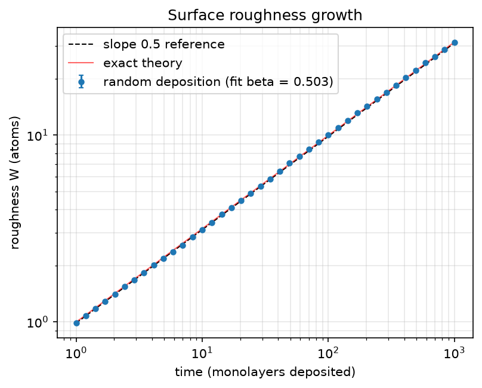
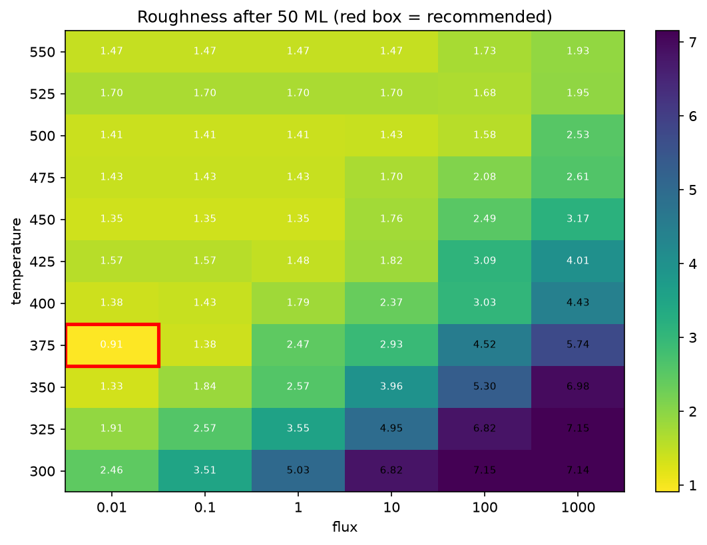
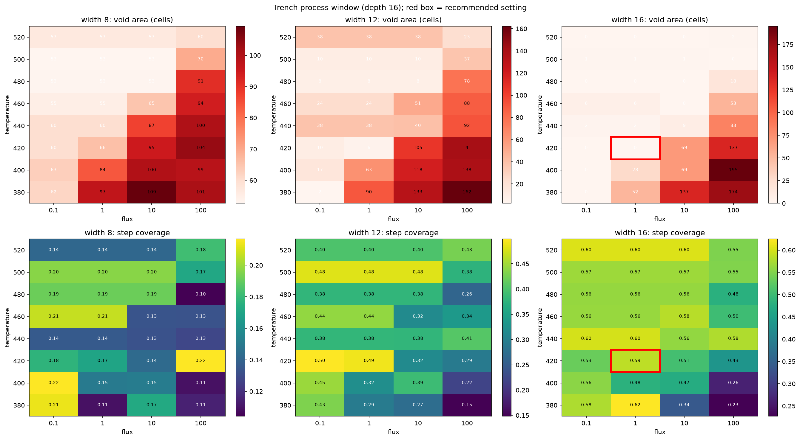

```{python}
#| echo: false
#| output: false
import json
import sys
from pathlib import Path

sys.path.insert(0, "../src")
import matplotlib.pyplot as plt
import numpy as np
import pandas as pd

from thin_film import fab
from thin_film.ideal import IDEAL

R = Path("../results")
def load(name):
    meta = json.loads((R / name / "settings.json").read_text())
    data = pd.read_csv(R / name / "data.csv") if (R / name / "data.csv").exists() else None
    return meta, data

p1, rd = load("phase1_random_deposition")
p2, sr = load("phase2_surface_relaxation")
p2t, timing = load("phase2_numba_timing")
_, t_sweep = load("phase3_temperature_sweep")
_, f_sweep = load("phase3_flux_sweep")
_, e_sweep = load("phase3_epsilon_sweep")
_, pw3 = load("phase3_process_window")
_, tr_t = load("phase4_temperature_sweep")
_, tr_w = load("phase4_width_sweep")
_, pw4 = load("phase4_process_window")
yld_meta, yld = load("por_yield")

beta1, beta1_err = p1["summary"]["beta"], p1["summary"]["beta_std_error"]
beta2, alpha2 = p2["summary"]["beta"], p2["summary"]["alpha"]
speedup = p2t["summary"]["speedup"]
w_cold, w_hot = t_sweep["roughness"].iloc[0], t_sweep["roughness"].min()
w_slow, w_fast = f_sweep["roughness"].iloc[0], f_sweep["roughness"].iloc[-1]
passes = yld.assign(ok=yld["result"] == "PASS").groupby(["module", "recipe"], sort=False)["ok"].agg(["sum", "count"])
por_th, por_tr = passes.loc[("thermal", "POR")], passes.loc[("trench", "POR")]
pw4_16 = pw4[pw4["trench_width"] == 16]
por4 = pw4_16[(pw4_16["temperature"] == 420) & (pw4_16["flux"] == 1.0)].iloc[0]
w8_best_void = pw4[pw4["trench_width"] == 8]["trench_void_area"].min()
```

::: {.callout-note appearance="simple"}
## Summary

* **The simulation reproduces exact theory.** Random deposition gives a growth exponent
  β = `{python} f"{beta1:.3f}"` (theory 1/2). Adding surface relaxation gives β = `{python} f"{beta2:.3f}"`
  and a saturation exponent α = `{python} f"{alpha2:.2f}"` (theory 1/4 and 1/2), the textbook
  Edwards–Wilkinson behaviour.
* **Heat smooths films and speed roughens them.** With temperature-activated hopping, roughness falls
  `{python} f"{w_cold / w_hot:.0f}"`× from 250 K to its minimum, and rises `{python} f"{w_fast / w_slow:.0f}"`× when the
  deposition rate goes from 0.01 to 1000 monolayers per second. Both act through one number: how many hops an atom
  makes before the next one lands on it.
* **Trench geometry matters more than temperature.** A trench twice as deep as it is wide traps a void at every
  temperature and rate tested (smallest average void: `{python} f"{w8_best_void:.0f}"` cells). A trench as wide as it is deep
  fills without voids once it is hot enough.
* **A process of record (POR).** For the trench, 420 K at 1 ML/s is void-free on average with step coverage
  `{python} f"{por4['step_coverage']:.2f}"`, and `{python} int(por_tr['sum'])` of `{python} int(por_tr['count'])` single wafers pass the spec.
  For the 1D film, 375 K at 0.01 ML/s passes `{python} int(por_th['sum'])` of `{python} int(por_th['count'])`.
* **Numba** makes the atom-by-atom loop `{python} f"{speedup:.0f}"`× faster than plain Python, which is what makes the
  interactive app possible.
:::

# Why thin films?

Every chip is built from films a few nanometres to a few hundred nanometres thick, stacked dozens of layers deep.
They are deposited by sending atoms at a wafer (sputtering, evaporation) and letting them settle. Two things decide
whether a film is usable:

1. **Roughness.** A rough film scatters electrons, makes the next layer uneven, and varies in thickness across the
   wafer. It is measured as **Rq**, the root-mean-square deviation of the surface height from its mean. In this
   report Rq is the same quantity physicists call the interface width **W**.
2. **Filling of features.** Wires and contacts are trenches and holes etched into the chip and then filled with
   metal. If the film closes over the top of a trench before the bottom has filled, it seals in an empty pocket, a
   **void**. Voids raise resistance and cause failures. The standard measure of how well a film reaches the bottom is
   **step coverage**: film thickness at the bottom of the trench divided by thickness on top.

Both depend on a race between two rates: how fast new atoms arrive, and how fast atoms already on the surface can
move to better positions. This report builds that race up one ingredient at a time, checking each step against
known theory before adding the next.

# The models

All models are **Monte Carlo** simulations: atoms arrive one at a time at random positions, and their behaviour is
decided by random draws with physically motivated probabilities. Every run uses a fixed random seed, so all results
here can be regenerated exactly (`scripts/run_phase{1..4}.py`, `scripts/run_por_yield.py`).

| Phase | Model | What an atom does | Question |
|---|---|---|---|
| 1 | Random deposition | Lands in a random column and stays | Is the code right? (Exact solution exists) |
| 2 | Surface relaxation | Rolls into a lower neighbouring column | What does the simplest smoothing do? |
| 3 | Thermal hopping | Hops sideways with probability e^(−n·E_bond/kT) | How do temperature and rate set roughness? |
| 4 | Trench fill (2D) | Sticks on first contact, then hops toward well-bonded sites | When does a trench trap a void? |

The 1D models describe a cross-section of a flat film as a row of columns; `heights[i]` is how many atoms are
stacked in column i. Boundaries are periodic, so the row behaves like a ring with no edges.

# Phase 1: random deposition, a validation baseline

Each atom picks a column uniformly at random and sticks on top of it. Columns never interact, so after t atoms each
column's height is a binomial random number and the width follows exactly

$$W(t) = \sqrt{\theta\,(1 - 1/N)}, \qquad \theta = t/N \text{ monolayers.}$$

On a log–log plot this is a straight line of slope **β = 1/2**. The simulation (200 columns, 30 runs averaged)
gives β = `{python} f"{beta1:.4f} ± {beta1_err:.4f}"` and matches the exact curve to within 5% at every time. This
confirms that the deposition loop, the roughness measurement and the fitting code are correct.

{width=70%}

The width **never saturates**. Because no column is affected by its neighbours, nothing limits how far apart
neighbouring heights can drift. Real films do not behave like this, which is the motivation for Phase 2.

# Phase 2: surface relaxation

Now a landed atom checks its two neighbours and rolls into a lower one (picking at random if both are lower). This
one local rule is the simplest form of surface diffusion, and it changes the large-scale behaviour completely.

```{python}
#| label: fig-relax
#| fig-cap: "Left: relaxation roughens much more slowly than random deposition. Right: roughness saturates, and the plateau rises with substrate width L."
fig, axes = plt.subplots(1, 2, figsize=(10, 3.8))
for L, d in sr.groupby("n_columns"):
    axes[1].loglog(d["monolayers"], d["roughness_mean"], "o-", ms=2.5, label=f"L = {L}")
d200 = sr[sr["n_columns"] == 200]
axes[0].loglog(d200["monolayers"], d200["roughness_mean"], "o", ms=3, label=f"relaxation (β = {beta2:.3f})")
axes[0].loglog(rd["monolayers"], rd["roughness_mean"], "o", ms=3, label=f"random deposition (β = {beta1:.3f})")
axes[0].set(xlabel="monolayers", ylabel="W (atoms)"); axes[1].set(xlabel="monolayers", ylabel="W (atoms)")
for ax in axes: ax.legend(fontsize=8); ax.grid(True, which="both", alpha=.3)
plt.tight_layout(); plt.show()
```

* **Slower growth:** β = `{python} f"{beta2:.3f}"` (theory 1/4), fitted over the first 100 monolayers on 200 columns.
* **Saturation:** once height differences have spread across the whole substrate, the width stops growing. The
  plateau scales as W_sat ∝ L^α with α = `{python} f"{alpha2:.2f}"` (theory 1/2), and the time to reach it as L².
  Rescaling time by L² and width by L^½ collapses all four curves onto one (see
  `results/phase2_surface_relaxation/figure.png`). This is the Family–Vicsek scaling that defines the
  Edwards–Wilkinson universality class.

**Why Numba.** In Phase 1 the order of arrivals did not matter, so atoms could be added in bulk with NumPy. Here
each atom's destination depends on the surface it finds, so atoms must be processed one by one in a loop. Compiling
that loop with Numba's `@njit` runs it at `{python} f"{timing['atoms_per_second'].iloc[1]:.2e}"` atoms/s instead of
`{python} f"{timing['atoms_per_second'].iloc[0]:.2e}"`, a **`{python} f"{speedup:.0f}"`× speed-up**. A test checks that both versions
build exactly the same film from the same random numbers.

# Phase 3: temperature and deposition rate

## The physics

Between landings, surface atoms try to hop sideways. A hop succeeds with probability

$$P_\text{hop} = e^{-n\,E_\text{bond}/kT},$$

where n ∈ {0, 1, 2} is the number of side neighbours at the atom's height. An isolated atom on a flat terrace hops
freely; an atom tucked against a step is held more strongly. Real conditions map onto two simulation numbers:

* **ε = E_bond / kT**: how sticky bonds are compared with the thermal energy.
* **hops per landing = ν₀·e^(−E_diff/kT) / F**: the Arrhenius hop rate of a free atom divided by the arrival rate F.
  It counts how many moves an atom gets before the next layer buries it.

The barriers are illustrative (E_bond = 0.2 eV, E_diff = 0.8 eV, ν₀ = 10¹³ s⁻¹), so temperatures are meaningful
relative to the model rather than for a specific metal.

## Results

```{python}
#| label: fig-thermal
#| fig-cap: "Roughness after 50 monolayers. Left: heating gives atoms more hops, so they find well-bonded sites. Right: at fixed temperature, faster deposition buries atoms before they can settle."
fig, axes = plt.subplots(1, 2, figsize=(10, 3.6))
axes[0].errorbar(t_sweep["temperature"], t_sweep["roughness"], t_sweep["roughness_sem"], fmt="o-", capsize=3)
axes[0].set(xlabel="substrate temperature (K)", ylabel="Rq (atoms)", title="flux 1 ML/s")
axes[1].errorbar(f_sweep["flux"], f_sweep["roughness"], f_sweep["roughness_sem"], fmt="o-", capsize=3, color="C1")
axes[1].set(xscale="log", xlabel="deposition rate (ML/s)", ylabel="Rq (atoms)", title="375 K")
for ax in axes: ax.grid(True, alpha=.3)
plt.tight_layout(); plt.show()
```

* Heating from 250 K to 450 K cuts roughness from `{python} f"{w_cold:.1f}"` to `{python} f"{w_hot:.1f}"` atoms.
* Slowing deposition 10⁵-fold at 375 K cuts it from `{python} f"{w_fast:.1f}"` to `{python} f"{w_slow:.1f}"`.
* **Temperature and rate are interchangeable** through the hop count. Every +40 K buys roughly 10× faster
  deposition at the same roughness. This is the trade-off fabs face between substrate heating (thermal budget) and
  throughput.
* **Bonds matter as much as mobility.** In the dimensionless model at 100 hops per landing, removing bonding
  entirely (ε = 0) makes the film *much* rougher (W = `{python} f"{e_sweep['roughness'].iloc[0]:.0f}"`). Atoms then wander uphill as
  easily as downhill. Even weak bonding (ε = 1) gives W = `{python} f"{e_sweep['roughness'].iloc[1]:.1f}"`: smoothing needs atoms that move
  *and* stay put once they find a good site.

## Process window and recipe

A grid over temperature × rate (`results/phase3_process_window`) finds the smoothest film at **375 K and
0.01 ML/s**. That is the coolest temperature at which slow deposition still gives the maximum number of hops while
bonds stay strong.

{width=65%}

# Phase 4: filling a trench

## The physics

This is a 2D side view of a wafer with a rectangular trench. Atoms fall straight down and **stick on first contact**,
below or beside them. Atoms grazing the trench's top corners stick to the corner's side, so the film grows sideways
from both corners as **overhangs**. If the overhangs meet before the bottom fills, they seal a void.

Temperature enters as in Phase 3: each new atom gets a number of hop attempts, succeeds with probability
e^(−n·ε) for n filled neighbours, and moves to the neighbouring empty cell with the most bonds. Hot atoms therefore
drift into corners and along the trench floor. Voids are found by a **flood fill** from the open space above: any
empty cell the flood cannot reach is sealed. (This model uses a weaker bond, E_bond = 0.1 eV. At 0.2 eV, bonded
atoms in 2D barely move and every trench voids.)


## Temperature and width

```{python}
#| label: fig-trench
#| fig-cap: "Trench 12 wide × 16 deep. Heating densifies the film and raises step coverage, and voids shrink sharply above about 400 K. Above about 460 K the void area creeps back up: hops are capped at 3000 per atom, so extra heat only weakens bonds."
fig, axes = plt.subplots(1, 3, figsize=(12, 3.4))
for ax, (col, lab) in zip(axes, [("step_coverage", "step coverage"), ("trench_void_area", "void area (cells)"),
                                 ("film_density", "film density")]):
    err = tr_t.get(f"{col}_sem")
    ax.errorbar(tr_t["temperature"], tr_t[col], err, fmt="o-", capsize=3)
    ax.set(xlabel="temperature (K)", ylabel=lab); ax.grid(True, alpha=.3)
plt.tight_layout(); plt.show()
```

```{python}
#| label: fig-width
#| fig-cap: "Fraction of runs with a trench void, by trench width (depth 16). Narrow, deep trenches void at any temperature; at 450 K trenches at least as wide as they are deep fill without a void in nearly every run (one run in six at width 24 trapped a 16-cell void)."
fig, ax = plt.subplots(figsize=(6.5, 3.4))
for T, d in tr_w.groupby("temperature"):
    ax.plot(d["trench_width"], d["void_probability"], "o-", label=f"{T:.0f} K")
ax.axvline(16, color="grey", ls=":", lw=1); ax.text(16.4, 0.9, "width = depth", fontsize=8, color="grey")
ax.set(xlabel="trench width (cells)", ylabel="fraction of runs with a void"); ax.legend(); ax.grid(True, alpha=.3)
plt.tight_layout(); plt.show()
```

The main lesson: **aspect ratio (depth ÷ width) decides first, temperature second.** In a deep, narrow trench the
corners are close together, so the overhangs meet after only a few monolayers. That happens long before diffusing
atoms can carry enough material to the bottom. Fabs face the same limit: line-of-sight deposition cannot fill
high-aspect-ratio features, which is why they turn to reflow, atomic layer deposition or electroplating.

## Process window and recipe

A grid over width × temperature × rate (`results/phase4_process_window`, 8 runs per cell) gives the POR:
**16 × 16 trench, 420 K, 1 ML/s**. It is void-free on average with coverage `{python} f"{por4['step_coverage']:.2f}"`.
That is within noise of the best coverage found, at a temperature 100 K lower than the best cell.



# From averages to wafers: yield

A spec applies to each wafer, not to an average. So the right question is *what fraction of single wafers pass?*
Each recipe was run with 30 seeds exactly as the app runs it (`results/por_yield`):

```{python}
#| label: tbl-yield
#| tbl-cap: "Single-wafer pass rates over 30 seeds."
tbl = passes.reset_index().rename(columns={"sum": "passed", "count": "wafers"})
tbl["spec"] = tbl["module"].map(lambda m: fab.SPECS[m]["text"])
tbl["yield"] = (100 * tbl["passed"] / tbl["wafers"]).round().astype(int).astype(str) + "%"
tbl[["module", "recipe", "spec", "passed", "wafers", "yield"]]
```

* The 1D POR passes every wafer. Its fast alternative (450 K, 1 ML/s) is 100× faster but passes only 80%.
* The trench POR passes about 80%. Failures are near misses: coverage just under 0.50, or a void of a few cells.
  Spread between wafers made with the same recipe is a real feature of growth, and it is why averages alone can
  mislead. A recipe that is void-free on average at 460 K and 10 ML/s passes only about half its wafers.

# Limitations

* **Lattice units.** 1 cell = 1 atom. The nanometre values in the app assume 1 monolayer ≈ 0.3 nm and are
  illustrative only.
* **Illustrative energies.** E_bond and E_diff are not fitted to any material, so only relative temperatures are
  meaningful.
* **Capped hops.** Runs are capped at 10⁴ hops per landing in 1D and 3000 per atom in 2D. The upturn in trench voids
  above about 460 K comes from this cap. A rejection-free kinetic Monte Carlo would remove it.
* **Simplified 2D motion.** Only the newest atom hops, and atoms arrive straight down. Real sputtering has an
  angular spread, which affects overhang growth directly.
* **Open seams.** A narrow seam that stays open to the surface is not counted as a void, by definition.

# Reproducing this report

```bash
python3.12 -m venv .venv && source .venv/bin/activate && pip install -r requirements.txt
for p in 1 2 3 4; do PYTHONPATH=src python scripts/run_phase$p.py; done
PYTHONPATH=src python scripts/run_por_yield.py
cd report && QUARTO_PYTHON=../.venv/bin/python quarto render report.qmd
```

Every result folder holds `settings.json` with the inputs, seed, fitted values and library versions.
