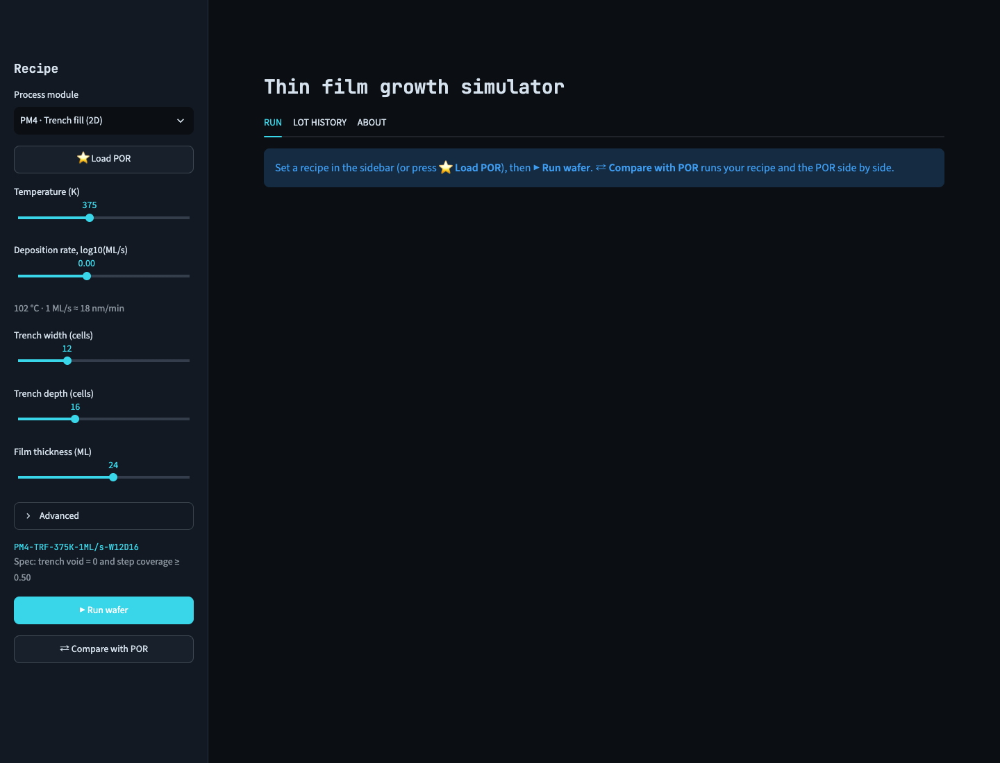
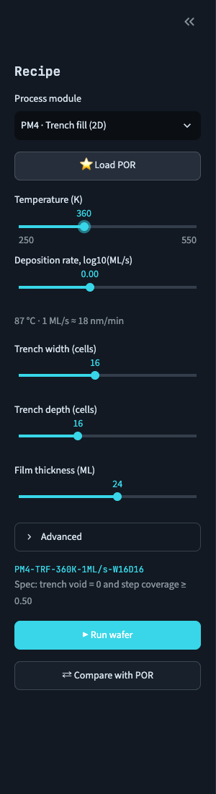
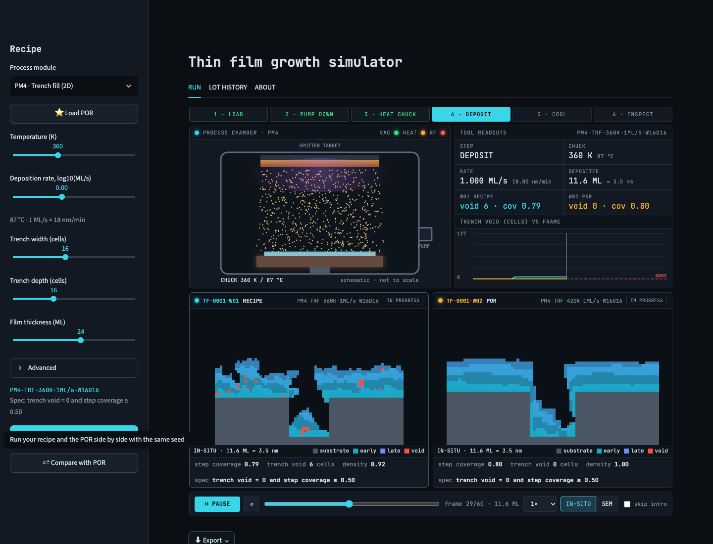
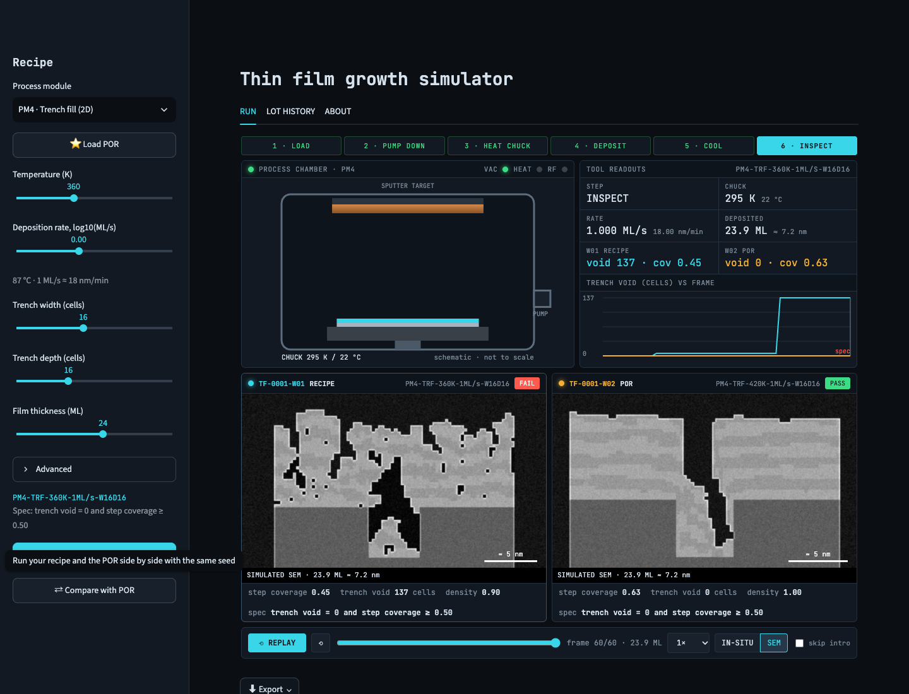
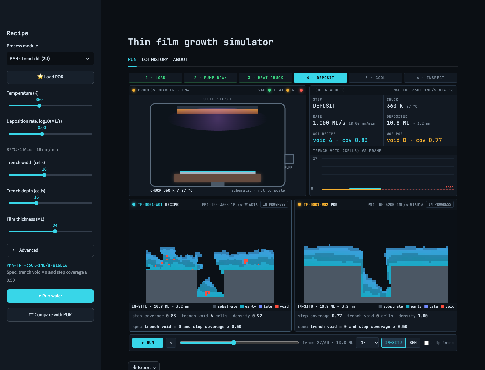
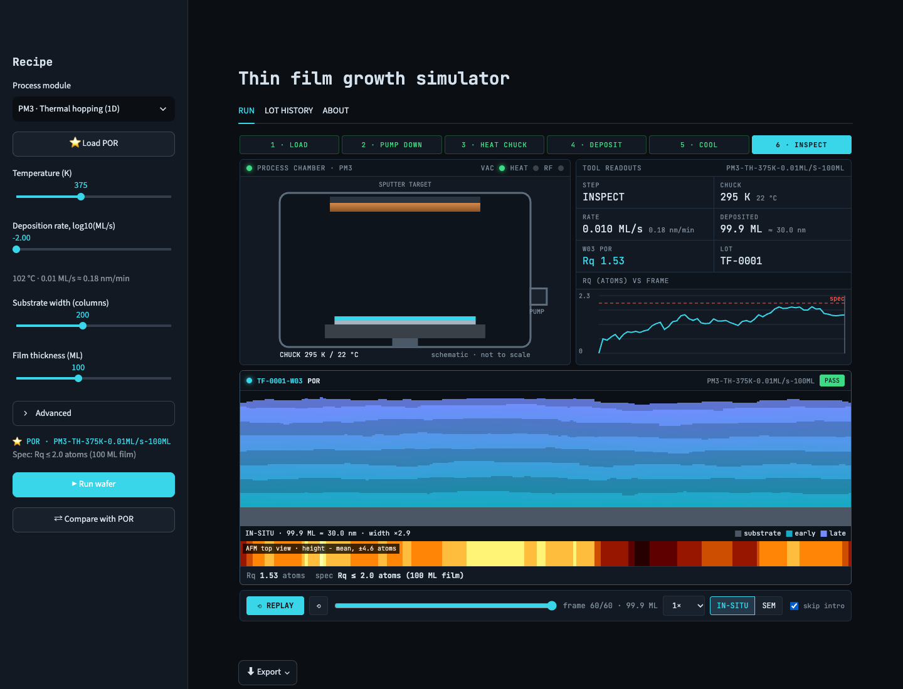
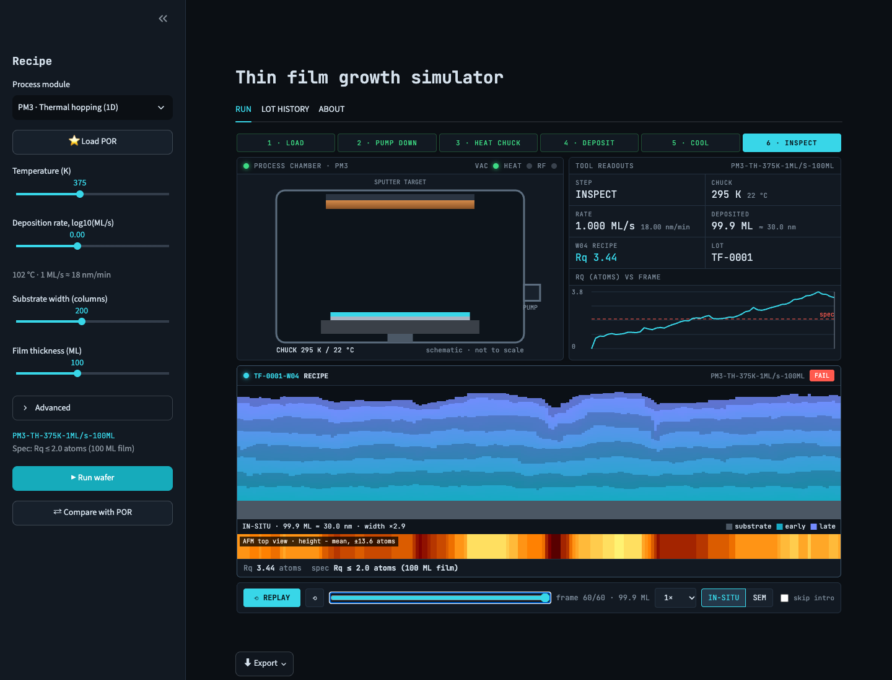
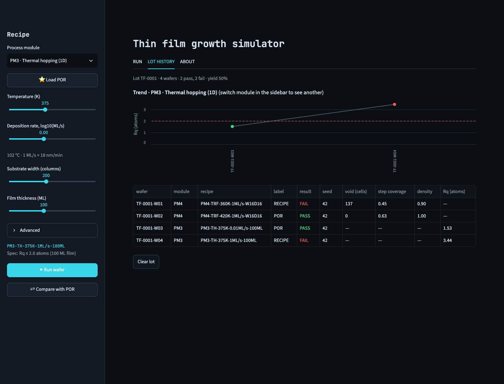

::: {.callout-tip appearance="simple"}
## In one minute

1. Pick a **process module** in the left sidebar (start with **PM4 · Trench fill**).
2. Press **⭐ Load POR** to load the recommended recipe, then move the **Temperature** slider down to about 360 K.
3. Press **⇄ Compare with POR**. Two wafers grow side by side: your colder recipe and the recommended one.
4. Watch the trench on the left seal over and trap a red **void**, while the one on the right fills.
   At the end both views switch to an SEM-style image and each wafer gets a **PASS** or **FAIL**.
:::

# What the app is

The app is a small virtual deposition tool. In a chip fab, thin films of metal or insulator are grown by firing
atoms at a silicon wafer. Whether the film comes out smooth, and whether it fills the tiny trenches etched into the
chip, depends on two settings you control here:

* **Temperature** of the wafer. Warmer atoms move around more after landing and settle into better spots.
* **Deposition rate**, i.e. how fast new atoms arrive. Fast arrival buries atoms before they can settle.

Every run is a real simulation of individual atoms (a Monte Carlo model), not a pre-recorded animation. The app
first computes the whole run, which takes under a second to a few seconds, and then replays it so you can pause and
rewind.

**Starting the app:** from the project folder run `streamlit run app/streamlit_app.py` and open the address it
prints (usually <http://localhost:8501>).

{.column-page}

# The screen at a glance

| Area | What it is for |
|---|---|
| **Sidebar · Recipe** | Choose the process module and its settings, load the recommended recipe, start runs |
| **RUN tab** | The tool: process steps, chamber, readouts and the growing film(s) |
| **LOT HISTORY tab** | Every wafer you have run this session, with pass/fail results and a trend chart |
| **ABOUT tab** | Short definitions, the reasoning behind the recommended recipe, the model's limits |

# Setting a recipe (sidebar)

{width=32%}

**Process module.** The four modules are four versions of the physics, from simplest to richest:

| Module | What atoms do | Use it to see… |
|---|---|---|
| **PM1 · Random deposition (1D)** | Land in a random spot and never move | The roughest possible film: roughness grows forever |
| **PM2 · Surface relaxation (1D)** | Roll into a lower neighbouring spot | How a little mobility smooths a film and makes roughness level off |
| **PM3 · Thermal hopping (1D)** | Hop sideways, more often when hot; well-bonded atoms stay put | How temperature and rate control roughness |
| **PM4 · Trench fill (2D)** | Stick where they first touch, then hop toward snug corners | When a trench fills cleanly and when it traps a void |

*1D* modules show a flat film in cross-section. *2D* shows a trench etched into the wafer.

**⭐ Load POR.** *POR* means *process of record*, the approved recipe a fab runs by default. Here it is the best
recipe found by searching many combinations (see the ABOUT tab for why). Loading it sets all sliders at once. The
recipe code under the sliders then starts with **⭐ POR**.

**Temperature (K).** Wafer temperature in kelvin; the caption below shows °C. Only PM3 and PM4 use it, and in PM1/PM2
the slider is greyed out because those atoms do not respond to heat.

**Deposition rate, log10(ML/s).** How fast atoms arrive, on a log scale: −2 means 0.01 monolayers per second (very
slow), 0 means 1 per second, 3 means 1000 per second. A *monolayer* (ML) is one atom-thick layer, roughly 0.3 nm.
The caption converts it to nm/min.

**Trench width / depth** (PM4) set the trench's shape. The ratio depth ÷ width is the *aspect ratio*. Deep, narrow
trenches are much harder to fill.

**Substrate width** (PM1–PM3) is how many atom columns wide the film is. **Film thickness** is how much material to
deposit.

**Advanced** (folded away): *Frames recorded* sets how many snapshots the replay has (more frames = smoother replay,
slightly slower to compute). *Random seed* picks which random sequence of atoms is used: the same seed always gives
the same wafer, and a different seed gives a different but equally valid wafer.

**Spec** under the recipe is the pass/fail rule for this module:

* PM3: roughness Rq ≤ 2.0 atoms.
* PM4: no void in the trench and step coverage ≥ 0.50.
* PM1/PM2: no spec. They are "monitor only", because there is nothing to tune.

**Run buttons.**

* **▶ Run wafer** grows one wafer with your recipe.
* **⇄ Compare with POR** grows your recipe *and* the POR side by side, using the same seed, so any difference comes
  from the recipe and not from luck.

# Watching a run (RUN tab)

{.column-page}

A run plays as six **process steps** across the top: *Load → Pump down → Heat chuck → Deposit → Cool → Inspect*.
Only **Deposit** is simulated; the other steps are short transitions that show what a real tool does around it. Tick
**skip intro** in the control bar to jump straight to Deposit next time.

## The chamber

The **process chamber** panel is a schematic of a sputtering tool:

* the copper-coloured **sputter target** at the top is where atoms come from;
* during Deposit a violet **plasma** glows under the target and gold dots (atoms) fall toward the wafer. A higher
  deposition rate means a brighter glow and more atoms;
* the **chuck** (the wafer holder) glows warmer the hotter the recipe, heats up during *Heat chuck* and cools at the
  end. It stays dark in PM1/PM2, which have no heater;
* the coloured strip on the wafer thickens as the film grows;
* the small lights in the panel header are tool status: **VAC** (vacuum reached), **HEAT** (chuck above room
  temperature), **RF** (plasma on).

The chamber is a drawing for orientation. Only the temperature, rate and film thickness come from the simulation.
In a comparison, **click a wafer's panel** to show that wafer's recipe in the chamber.

## Tool readouts

The readouts panel lists the current step, chuck temperature, rate, the thickness deposited so far, and **each
wafer's key number side by side** (W01 is your recipe, W02 the POR):

* trench modules show **void** (sealed empty cells) and **cov** (step coverage);
* 1D modules show **Rq** (roughness).

Below it, the **trace** plots that number against time for every wafer, with the spec limit as a red dashed line.

## The wafer views

Each wafer has its own panel: wafer ID, label (RECIPE or POR), recipe code, and a status chip that reads
**IN PROGRESS** until the end, then **PASS**, **FAIL** or **MONITOR**.

**In-situ view (default).** A false-colour cross-section of the film as it grows:

* grey is the original wafer (substrate);
* teal → blue is the new film, coloured by *when* it grew. Early atoms are teal, late atoms blue, with alternating
  bands like the rings of a tree. The bands let you see the order in which the film built up, for example overhangs
  growing inward from the trench corners;
* **red** is a void: empty space sealed off from the surface.

**SEM view.** At *Inspect* the views switch automatically to a black-and-white image in the style of a scanning
electron microscope, which is how engineers actually inspect cross-sections. Edges glow, the film has a grainy
texture, voids are black pockets and there is a scale bar. It is a rendering of the simulation, so it is labelled
*SIMULATED SEM*.

{.column-page}

**AFM strip (1D modules only).** A thin coloured bar under the film, as if looking down on the surface with an
atomic force microscope: bright = higher than average, dark = lower. The colours stretch to each run's own height
range, so even a smooth film uses the full scale. To compare films, read the **± number in the strip's label**
(the largest bump or dip, in atoms) and look at the stripes: smooth films have broad, gentle bands and rough films
narrow, jagged ones. Use it for 1D films, where the cross-section view squeezes roughness of a few atoms into a
thin line.

**Caption strip** under each view shows the thickness so far, and for 1D views how much the picture is stretched (for
example *width ×2.9*). 1D films are drawn wider than true scale so the surface is visible.

**Metrics line** under each view: step coverage, trench void and film density (PM4), or Rq (PM1–PM3), plus the spec.

## Playback controls

| Control | What it does |
|---|---|
| **▶ RUN / ⏸ PAUSE / ⟲ REPLAY** | Play or pause; after the end, replays from the start |
| **⟲** (small button) | Restart the whole sequence |
| **Slider** | Scrub to any moment of the deposition; the readouts and trace follow |
| **Speed** | 0.5× to 4× playback |
| **IN-SITU / SEM** | Switch the wafer views at any time |
| **skip intro** | Start at Deposit instead of Load |

{.column-page}

::: {.callout-note}
**Read the final frame, not the middle.** Mid-run numbers can be misleading. In the comparison above, the cold wafer
shows step coverage 0.79 halfway through, but once its trench seals the bottom stops receiving atoms and it ends at
0.45. Results and PASS/FAIL always refer to the final frame.
:::

# Three guided experiments

## Why do trenches trap voids?

1. Select **PM4**, press **⭐ Load POR**, then lower **Temperature** to 360 K.
2. Press **⇄ Compare with POR** and watch both trenches.
3. On the cold wafer, atoms stick where they first touch. Those grazing the trench's top corners build ledges that
   grow toward each other. When they meet, a red void appears and the trace jumps.
4. On the POR wafer, atoms have enough heat to slide down into the trench before sticking for good, so the trench
   fills from the bottom.

Then try the geometry: set **Trench width** to 8 (twice as deep as wide) and compare again. At this aspect ratio no
temperature avoids a void, because the corners are simply too close together. This is the biggest lesson of the model:
**shape first, temperature second.**

## How do heat and speed set roughness?

1. Select **PM3**, press **⭐ Load POR** (375 K, 0.01 ML/s) and **▶ Run wafer**. The AFM strip shows broad bands
   with a range of about ±5 atoms, and Rq ends below the spec.
2. Move the **rate** slider to 0 (1 ML/s) and run again. The surface line is visibly bumpier, the AFM range
   roughly triples (±14 atoms) with narrower stripes, and the wafer fails.

{width=49%} {width=49%}

3. Now raise the temperature to about 450 K at 1 ML/s. The film is nearly as smooth as the POR. Heat and slow
   deposition do the same job: both give atoms more chances to hop before they are buried.

## What does a little mobility do?

Select **PM1**, press **⭐ Load POR** and run it, then do the same for **PM2**. In PM1 the trace keeps climbing,
because roughness grows like √time with no limit. In PM2 the trace bends over and flattens into a plateau, because
rolling downhill keeps neighbouring columns at similar heights. Narrower substrates flatten sooner: try PM2 with a
substrate width of 50.

# Lot history

{.column-page}

Every wafer gets an ID like **TF-0001-W03** (lot TF-0001, wafer 3).

* The **summary line** counts pass/fail and the *yield*: the share of wafers with a spec that passed.
* The **trend chart** shows the selected module's wafers in order, green for pass and red for fail, with the spec
  limit dashed. Switch module in the sidebar to see another module's trend.
* The **wafer log** lists every wafer's recipe and results. A dash (—) means the metric does not apply to that
  module.
* **Clear lot** starts over.

The history lasts while the browser tab is open. Use **Export** to keep it.

::: {.callout-note}
**Why does the POR sometimes fail?** Each wafer uses its own random sequence of atoms, so two wafers made with the
same recipe differ, just as real wafers do. Over 30 test wafers, the PM3 POR passed 30 of 30 and the PM4 POR passed
24 of 30. The failures are near misses (coverage just under 0.50 or a tiny void). Try a few seeds under **Advanced**
to see the spread.
:::

# Exporting

The **⬇ Export** menu under the run offers:

* **Replay (standalone HTML):** the full animated tool view as a single file that opens in any browser, offline.
* **Recipe & settings (JSON):** every input of the run, including the seed, so it can be reproduced exactly.
* **Lot history (CSV):** the wafer log for a spreadsheet.

# Troubleshooting

| You see… | Why, and what to do |
|---|---|
| "Simulating…" for several seconds | PM3 at high temperature or slow rates does up to 10,000 hops per atom. It is cached, so re-running the same recipe is instant |
| The 1D film looks perfectly flat | Roughness of a few atoms is tiny next to 100 ML of thickness; read the **AFM strip** and **Rq** instead |
| "(capped)" next to hops under Advanced | The hop count hit its computational limit; heating further changes little |
| A dark slit in a filled trench (SEM) | A seam still open to the surface. It is not sealed, so it is not counted as a void |
| Temperature slider greyed out | PM1/PM2 have no temperature dependence |
| Compare shows two identical wafers | Your recipe already is the POR |

# Glossary

| Term | Meaning |
|---|---|
| **Monolayer (ML)** | One atom-thick layer over the whole surface, about 0.3 nm in this app |
| **Rq** | RMS roughness: how far the surface height typically differs from its average, in atoms |
| **Step coverage** | Film thickness at the trench bottom ÷ thickness on top. 1 = even; near 0 = the bottom barely gets any |
| **Void** | Empty space sealed inside the film, found by flood-filling from the open space above |
| **Film density** | Fraction of the film that is solid; cold films are porous (about 0.5) |
| **Aspect ratio** | Trench depth ÷ width |
| **POR** | Process of record: the recommended recipe |
| **Spec / PASS / FAIL / MONITOR** | The pass rule for a wafer; MONITOR means the module has no rule |
| **Seed** | The number that fixes the random sequence of atoms, making a run reproducible |
| **In-situ / SEM / AFM** | The live false-colour view / a microscope-style cross-section / a top-down height map |

For the science and the results behind the recipes, see the companion report, *How Thin Films Grow*
(`report/report.html`).
